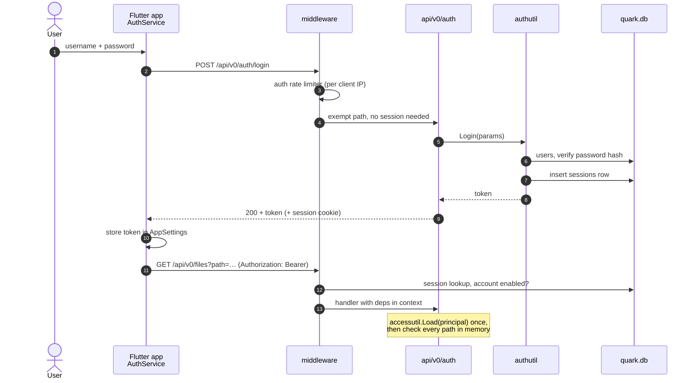
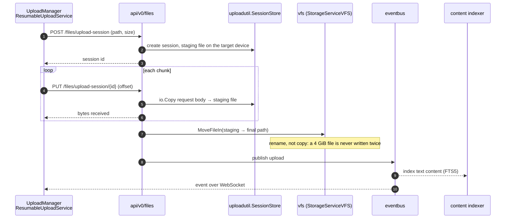
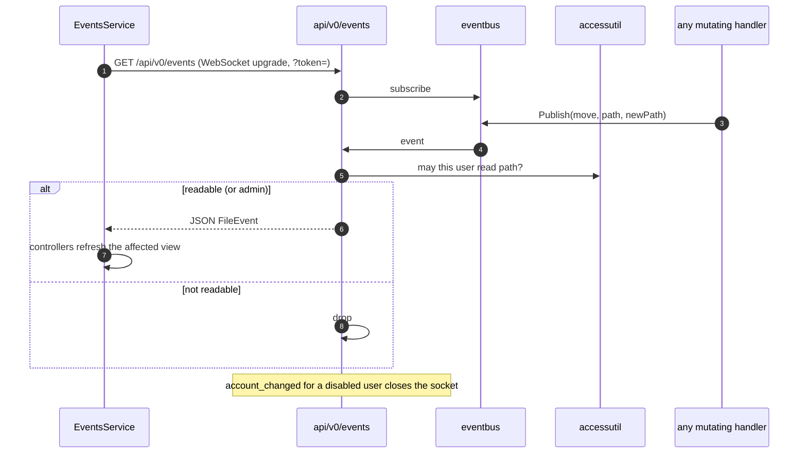
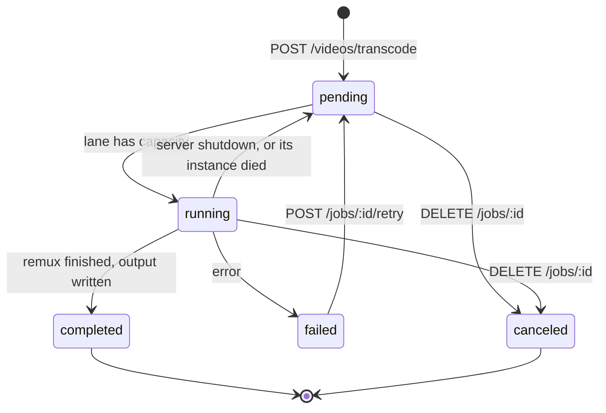
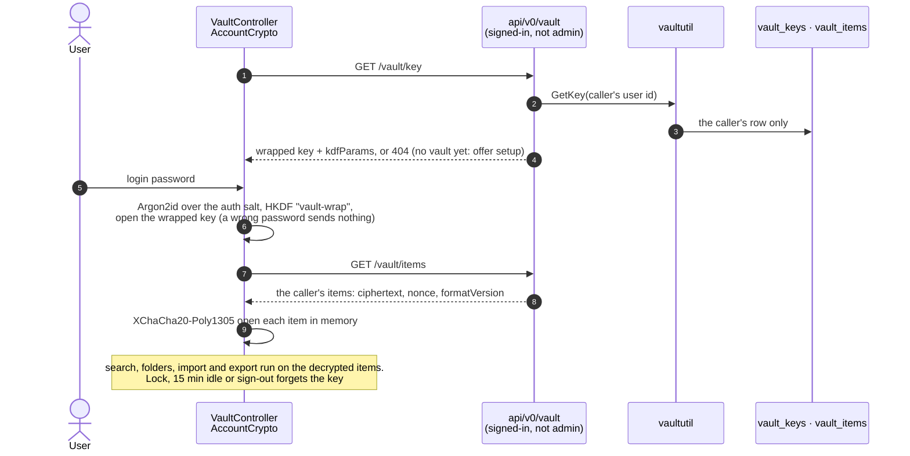

# Request flows

The paths below cover most of what the backend does at runtime. Each diagram names the package that owns each
step, so it doubles as a map for where to start reading.

## Sign-in and an authenticated request

## Streaming upload (resumable, chunked)

Large files use an upload session, so a dropped connection resumes instead of restarting and no chunk is ever
held whole in memory.

Small files take `POST /files/upload`, which streams the multipart body straight into `vfs.Write`. An abandoned
session is swept by the upload-session sweeper.

## Live events

## Background job (video transcode)

A job is a row in the `jobs` table, so history survives a restart. A running row names the instance that owns
it, which keeps it with a heartbeat, so several instances can share the queue. Every transition publishes a `job_*` event;
`GET /api/v0/jobs` remains the source of truth for the Jobs page.

## Vault unlock

Each account's vault is end-to-end encrypted (#3456). The Quark stores the account's vault key only wrapped and
every item only as ciphertext, so unlocking is work the app does; the Quark serves bytes it cannot open.

Setup is the same in reverse: the app makes a random 32-byte key, wraps it under the password's `vault-wrap` key,
and under the recovery phrase's `recovery-vault-wrap` key when the user typed the phrase at setup, and stores it
with `PUT /vault/key`. That request carries the password's auth key as `password`, which the Quark re-confirms
first (403 for any other password, under the sign-in rate limit), so the key is only ever wrapped under the login
password. It refuses a second key with 409, so a vault's key is never replaced, only re-wrapped. A password change, a recovery and a new recovery phrase send the key re-wrapped as `vaultKey` in
`PUT /auth/password`, `POST /auth/recover` and `PUT /auth/recovery-key`, in the same transaction as the credential
(`POST /auth/recover/vault-key` hands a recovery the wrapped key first). Every write publishes `vault_changed`,
which `accessutil.FilterEvent` delivers only to the account whose vault it is, so its other sessions read the
vault again. `DELETE /vault` removes the key and every item, the way out for a vault nothing opens any more.
